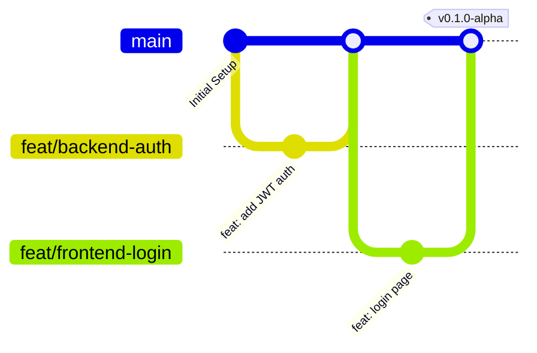

# Contributing to Smart Event Platform

Welcome to the **Smart Event Management & Marketplace Platform** project repository. 

As a multi-disciplinary engineering project combining Frontend, Backend, AI Microservices, and Academic Documentation, maintaining high engineering standards and seamless collaboration is vital.

This guide outlines our team development workflow, coding standards, branch strategies, commit conventions, and review policies.

---

## 📑 Table of Contents

- [1. Team Structure & Module Ownership](#1-team-structure--module-ownership)
- [2. Branching Strategy (Git Flow Lite)](#2-branching-strategy-git-flow-lite)
- [3. Commit Message Conventions](#3-commit-message-conventions)
- [4. Local Development Expectations](#4-local-development-expectations)
- [5. Code Quality & Formatting Standards](#5-code-quality--formatting-standards)
- [6. Pull Request (PR) Workflow](#6-pull-request-pr-workflow)
- [7. Code Review Guidelines](#7-code-review-guidelines)
- [8. Documentation Update Rules](#8-documentation-update-rules)
- [9. Issue & Task Management](#9-issue--task-management)
- [10. Merge Conflict Resolution](#10-merge-conflict-resolution)

---

## 1. Team Structure & Module Ownership

| Role Area | Responsibilities | Primary Scope |
|---|---|---|
| **Frontend Contributors** | Responsive UI components, state management, API integration, WebSocket listeners for gate check-in, form validations, responsive design. | `frontend/` |
| **Backend Contributors** | RESTful API endpoints, Prisma schema migrations, authentication, RBAC authorization, transactional consistency, WebSocket events. | `backend/` |
| **AI Contributors** | FastAPI microservice endpoints, NLP slot extraction, hybrid recommendation models, logistics planning algorithms, supplier matching. | `ai-service/` |
| **Documentation & Analysis** | Academic book chapters, UML diagrams, API contract specifications, user manuals, and presentation materials. | `assets/`, `docs/`, `README.md` |

Every contributor is responsible for their domain while coordinating across boundaries when data contracts or APIs evolve.

---

## 2. Branching Strategy (Git Flow Lite)

To maintain stability and protect deployment branches, our team follows a structured branching strategy:



### Branch Roles
1. `main`: **Production / Golden Reference Branch**
   - Contains only stable, reviewed, and supervisor-approved milestones.
   - Direct commits and force pushes are strictly prohibited.
   - All feature branches are created from `main` and merged back into `main` via Pull Request.
2. `feat/<module>-<short-description>`: **New Features**
   - Examples: `feat/frontend-discovery-page`, `feat/backend-rfq-api`, `feat/ai-recommendation-engine`
3. `fix/<module>-<short-description>`: **Bug Fixes**
   - Examples: `fix/backend-ticket-concurrency`, `fix/frontend-mobile-scanner`
4. `docs/<short-description>`: **Documentation & Academic Work**
   - Examples: `docs/chapter-4-design-update`, `docs/api-contracts-checkin`
5. `refactor/<module>-<short-description>`: **Code Restructuring**
   - Restructuring without altering functional behavior.
6. `chore/<short-description>`: **Maintenance & Dependencies**
   - Examples: `chore/update-prisma`, `chore/setup-ci`
7. `hotfix/<short-description>`: **Critical Emergency Fixes**
   - Reserved for critical bugs blocking team testing directly on `main`.

---

## 3. Commit Message Conventions

We enforce the **Conventional Commits** specification (`<type>(<scope>): <subject>`).

### Structure
```text
<type>(<scope>): <short imperative summary>

[optional body explaining motivation and technical approach]

[optional footer referencing issues, e.g., Resolves #12]
```

### Supported Types
- `feat`: A new feature for the user or API consumer.
- `fix`: A bug fix.
- `docs`: Documentation changes only.
- `style`: Formatting, missing semicolons, whitespace (no code change).
- `refactor`: Refactoring production code without changing behavior.
- `perf`: Code change that improves performance.
- `test`: Adding or updating automated tests.
- `chore`: Updating build scripts, package dependencies, or configuration.

### Common Scopes
- `frontend`, `backend`, `ai`, `database`, `auth`, `checkin`, `rfq`, `booking`, `docs`, `config`

### Examples
```text
feat(backend): implement QR ticket signature verification
feat(frontend): add responsive ticket wallet view
feat(ai): integrate hybrid recommendation scoring model
fix(auth): correct token expiration handling in refresh middleware
docs(phase1): update ERD diagram notes in index catalog
refactor(database): optimize ticket availability query with indexed joins
```

---

## 4. Local Development Expectations

- **Do Not Push Secrets:** Never commit `.env`, private keys, passwords, database credentials, or tokens.
- **Run Local Checks:** Verify that code compiles and linting passes before opening a Pull Request.
- **Preserve Clean Environments:** Use virtual environments (`venv`) for Python and `npm`/`pnpm` lockfiles for Node.js.
- **Contract Adherence:** Backend and AI developers must respect the established API contracts documented in [`assets/phase1-analysis/phase1.md`](file:///d:/programming/laragon/www/event-smart/assets/phase1-analysis/phase1.md).

---

## 5. Code Quality & Formatting Standards

### TypeScript & JavaScript (Frontend & Backend)
- Use **TypeScript** strictly with explicit interface and type definitions. Avoid `any`.
- Adhere to **camelCase** for variable and function names.
- Use **PascalCase** for React components, classes, and TypeScript types/interfaces.
- Use **UPPER_SNAKE_CASE** for configuration constants and environment variables.
- Maintain error-handling middleware in Express; do not leave uncaught Promise rejections.

### Python (AI Service)
- Follow **PEP 8** style guidelines.
- Use Python **type hints** across all FastAPI function signatures.
- Use **Pydantic** models for all incoming and outgoing request payloads.
- Use **snake_case** for variables, functions, and module names.
- Use **PascalCase** for classes and Pydantic schemas.

### Database (Prisma / MySQL)
- Table names use `snake_case` plural (e.g., `ticket_types`, `service_orders`).
- Primary keys are named `id`. Foreign keys follow the format `<singular_entity>_id` (e.g., `event_id`, `user_id`).
- Always create migrations via `npx prisma migrate dev --name <descriptive_name>`. Never modify production databases directly.

---

## 6. Pull Request (PR) Workflow

1. **Pull Latest Changes:** Before opening a PR, ensure your branch is rebased or up-to-date with `main`.
2. **Fill the PR Template:** Complete all sections in [`.github/PULL_REQUEST_TEMPLATE.md`](file:///d:/programming/laragon/www/event-smart/.github/PULL_REQUEST_TEMPLATE.md):
   - Clear summary of changes.
   - Affected modules (`frontend`, `backend`, `ai-service`, `assets`, `docs`).
   - Testing steps and verification evidence (screenshots, test outputs).
   - Confirmation checklist.
3. **Link Associated Issues:** Reference relevant issue IDs (e.g., `Closes #14`).
4. **Draft PRs:** If work is still underway but requires team feedback, open it as a **Draft PR**.

---

## 7. Code Review Guidelines

- **Constructive & Respectful:** Reviews must be collaborative, educational, and polite. Critique the code, not the author.
- **Verification Focus:** Reviewers must check:
  - Does the implementation match the architectural specifications in Phase 1 documentation?
  - Are there any potential security vulnerabilities, SQL injections, or unauthenticated endpoints?
  - Are error cases properly handled with clear user-facing messages?
  - Did the change break any existing API contracts?
- **Approval Rule:** At least one peer review approval from the affected module lead is required before merging into `main`.

---

## 8. Documentation Update Rules

Documentation is an equal deliverable alongside source code in this graduation project:
- If you modify an API endpoint, update the API specification in [`assets/phase1-analysis/phase1.md`](file:///d:/programming/laragon/www/event-smart/assets/phase1-analysis/phase1.md) or [`docs/INDEX.md`](file:///d:/programming/laragon/www/event-smart/docs/INDEX.md).
- If database models change, update the corresponding Prisma schema and ERD documentation.
- When finishing an academic milestone, coordinate with the documentation team to reflect updates in the corresponding chapter in `assets/Book_Chapters/`.

---

## 9. Issue & Task Management

All development tasks and defect reports must use our GitHub Issue Templates:
- **Bug Reports:** Use [`.github/ISSUE_TEMPLATE/bug_report.md`](file:///d:/programming/laragon/www/event-smart/.github/ISSUE_TEMPLATE/bug_report.md) with reproduction steps, environment details, and expected vs. actual behavior.
- **Feature Requests:** Use [`.github/ISSUE_TEMPLATE/feature_request.md`](file:///d:/programming/laragon/www/event-smart/.github/ISSUE_TEMPLATE/feature_request.md) with architectural rationale, affected modules, and acceptance criteria.
- **Development Tasks:** Use [`.github/ISSUE_TEMPLATE/task.md`](file:///d:/programming/laragon/www/event-smart/.github/ISSUE_TEMPLATE/task.md) for breaking down user stories into assignable engineering chunks.

---

## 10. Merge Conflict Resolution

- When conflicts arise, rebase or merge `main` into your feature branch locally.
- Test that the resolution compiles and all modules interact correctly before pushing.
- Never use forceful flags (`--force`) on the shared branch (`main`).
- If you are unsure how to resolve a conflict that affects another member's code, conduct a pair-programming session with that member to resolve it together.

