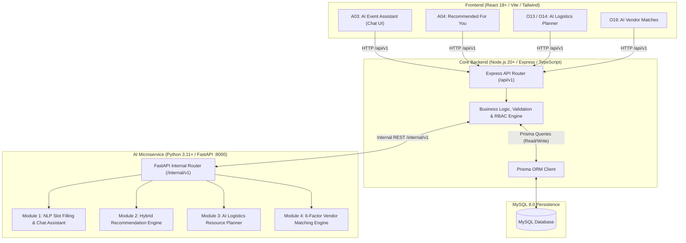
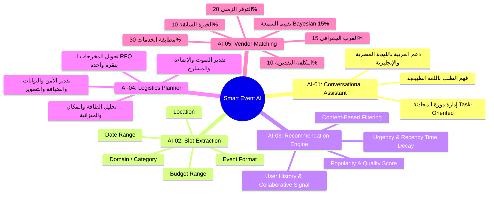
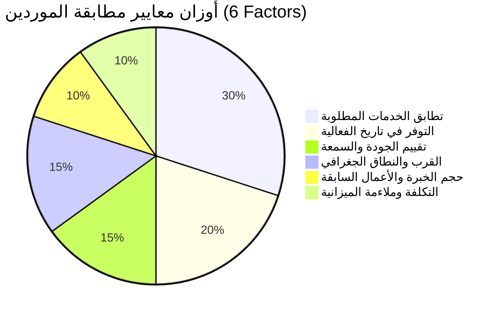
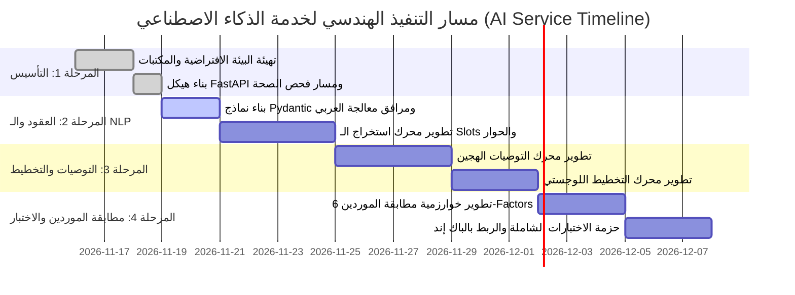

# Smart Event — AI Microservice Engineering Roadmap & Implementation Guide
## دليل مهندس الذكاء الاصطناعي وخارطة الطريق الهندسية الشاملة

> **المرجعية الأساسية:** وثيقة المشروع المعتمدة [`assets/details/pdf_content.txt`](../assets/details/pdf_content.txt)، وثيقة التحليل [`assets/phase1-analysis/phase1.md`](../assets/phase1-analysis/phase1.md)، المعمارية [`docs/ARCHITECTURE.md`](./ARCHITECTURE.md)، والقواعد المعمارية [`docs/adr/0001-modular-monolith-with-fastapi-ai.md`](./adr/0001-modular-monolith-with-fastapi-ai.md) و [`docs/adr/0002-advisory-ai-golden-rule-and-fallback.md`](./adr/0002-advisory-ai-golden-rule-and-fallback.md).

---

## 1. الرؤية الهندسية وموقع الـ AI في المنصة (Architectural Position)

في منصة **Smart Event**، لا يعمل موديول الذكاء الاصطناعي كخادم رئيسي (Main Backend)، بل كـ **AI Microservice مستقل** مبني بلغة **Python 3.11+ و FastAPI**، ويعمل على المنفذ الداخلي `8000` تحت المسار الأساسي `/internal/v1`.

### 1.1 المخطط المعماري لتدفق البيانات (Service Topology & Interaction)



### 1.2 القاعدة الذهبية للذكاء الاصطناعي (The Golden Rule - ADR-0002)
> **الـ AI لا يملك أي سلطة تنفيذية مباشرة (No Direct Business Authority):**  
> مخرجات الـ AI تعتبر **اقتراحات استرشادية (Advisory Suggestions)** فقط.
> 
> $$\text{AI (Suggest)} \longrightarrow \text{Node.js Backend (Validate)} \longrightarrow \text{User (Confirm)} \longrightarrow \text{Execution}$$
> 
> 1. الـ AI Microservice لا يتصل مباشرة بقاعدة البيانات للكتابة، ولا يغير حالات الحجز أو التذاكر أو العقود.
> 2. الباك إند هو من يرسل البيانات المطلوبة (Candidate Data) للـ AI، ويستقبل النتائج المقترحة مع درجات الثقة والأسباب (`score` + `match_reasons`).
> 3. **وضع التعافي (Fallback Mode - NFR-09):** في حال توقف سيرفر الـ AI أو حدوث خطأ فيه، يجب ألا يتعطل النظام؛ حيث يقوم الباك إند تلقائياً بالتحول إلى البحث النصي الكلاسيكي بـ SQL (Keyword Matching).

### 1.3 معمارية المحرك المزدوج (Dual-Engine: Local & External Cloud API)
> [!TIP]
> يدعم الـ AI Microservice العمل بـ **نمطين مرنين (Strategy Pattern)** يتم التبديل بينهما عبر ملف `.env`:
> 1. **المحرك المحلي (Local Engine):**
>    - يعتمد على خوارزميات مفتوحة المصدر مجانية بالكامل تعمل بدون إنترنت: `scikit-learn` (TF-IDF, Cosine Similarity, Bayesian Rating)، ومكتبات معالجة النصوص وقواعد الأنماط (Regex + Rules / spaCy)، ونماذج التضمين اللغوي الخفيفة (`sentence-transformers/paraphrase-multilingual-MiniLM-L12-v2`) أو LLM محلي عبر Ollama.
>    - **المميزات:** تكلفة صفرية (\$0)، زمن استجابة سريع جداً (< 100ms)، عدم الحاجة لإنترنت أو مفاتيح API، مثالي للاختبارات ومناقشة المشروع.
> 2. **المحرك السحابي الخارجي (External Cloud API Engine):**
>    - يعتمد على واجهات برمجية سريعة واقتصادية للموديلات الحديثة (مثل: **Google Gemini 1.5/2.0 Flash**, **OpenAI GPT-4o-mini**, أو **Groq / DeepSeek**).
>    - **المميزات:** فهم فائق للهجة المصرية والعامية العربية، استخراج المحددات (Slots) بدقة متناهية عبر Structured Outputs، وتوليد إجابات طبيعية وذكية جداً في المحادثة.
> 3. **التحويل التلقائي عند الطوارئ (Automatic Fallback):**
>    إذا تم ضبط النظام على المحرك الخارجي (`AI_PROVIDER=external`) وحدث انقطاع للإنترنت أو نفاد للرصيد/الـ Quota أو Timeout، يقوم الكود تلقائياً بالتحول للمحرك المحلي دون إرجاع خطأ للمستخدم.

---

## 2. تفكيك وتحليل الموديولات الخمسة للـ AI (Functional Deep Dive)

من واقع وثائق المشروع، يتولى مهندس الـ AI تطوير **4 مسارات رئيسية** تغطي **5 متطلبات وظيفية**:



---

### الموديول الأول والثاني: المساعد الذكي واستخراج المحددات (AI-01 & AI-02: NLP & Slot Filling)
* **الشاشة المعنية:** `A03 — AI Event Assistant`.
* **الـ Endpoint الداخلي:** `POST /internal/v1/nlp/chat`.
* **الهدف الوظيفي:** استيعاب طلب الحاضر باللغة الطبيعية (عربي / إنجليزي)، وتحويله إلى محددات استعلام مهيكلة (Structured Query)، مع توجيه أسئلة متابعة تلقائية في حال نقص أي من البيانات الأساسية.
* **المحددات الخمسة الإلزامية (Slots):**
  1. `category`: تصنيف الفعالية (Technology, Business, Art, Music, Sports, Healthcare...).
  2. `format`: طبيعة الحضور (`IN_PERSON`, `ONLINE`, `HYBRID`).
  3. `location`: المدينة أو المحافظة (Cairo, Alexandria, Giza...) أو الإحداثيات التقريبية.
  4. `budget`: ميزانية التذكرة (`min_price`, `max_price`, أو `free_only: true`).
  5. `date`: النطاق الزمني (`start_date`, `end_date`) مع فهم التعبيرات النسبية ("الجمعة الجاية"، "الأسبوع القادم"، "الشهر ده").
* **سلوك النظام في الحوار (Dialogue State Tracking - DST):**
  - **حالة عدم اكتمال البيانات (`is_complete = false`):** إذا قال المستخدم *"عايز إيفنت تك الأسبوع الجاي"*، يستخرج النظام التصنيف والتاريخ، ويكتشف غياب الموقع والميزانية، فيرد بسؤال استيضاحي ودود: *"تحب الفعالية تكون في أي مدينة؟ (مثلاً: القاهرة أو الإسكندرية) وهل تفضل تكون أونلاين؟"*.
  - **حالة اكتمال البيانات (`is_complete = true`):** يُرجع النظام كائن الـ Slots المستخرجة كاملة مع كائن فلاتر SQL مهيكل (`query_filters`) ليقوم الباك إند بجلب الفعاليات المطابقة فوراً.

---

### الموديول الثالث: محرك التوصيات الهجين (AI-03: Hybrid Recommendation Engine)
* **الشاشة المعنية:** `A04 — Recommended For You` والصفحة الرئيسية `A01`.
* **الـ Endpoint الداخلي:** `POST /internal/v1/recommend/hybrid`.
* **الهدف الوظيفي:** تقديم ترتيب مخصص للفعاليات لكل مستخدم بالاعتماد على نموذج هجين يدمج 4 معايير بأوزان متغيرة:
  1. **المطابقة المعتمدة على المحتوى (Content-Based Score - $S_{\text{content}}$):**
     تشابه نصوص الفعالية (العنوان، الوصف، الفئة، الكلمات المفتاحية) مع اهتمامات المستخدم المخزنة في بروفايله، باستخدام متجهات النصوص (TF-IDF أو MiniLM Multilingual Embeddings) مع تشابه جيب التمام (Cosine Similarity).
  2. **سجل التفاعل والتاريخ الشخصي (Interaction Affinity - $S_{\text{history}}$):**
     الفعاليات السابقة التي حجزها المستخدم، والتقييمات الإيجابية التي منحها، والفعاليات المحفوظة في مفضلته (`favorites`).
  3. **شعبية الفعالية وجودتها (Popularity & Quality Score - $S_{\text{popularity}}$):**
     معدل المشاهدات، سرعة الحجز، ومتوسط تقييم الحضور السابقين (1–5).
  4. **عامل الوقت والإلحاح (Urgency & Recency Decay - $S_{\text{urgency}}$):**
     إعطاء أولوية للفعاليات القادمة خلال (1–14 يوماً) مقارنة بالفعاليات البعيدة، مع تقليل وزن الفعاليات المنتهية أو التي بدأت بالفعل.
* **المعادلة الرياضية للترتيب:**
  $$S_{\text{final}} = w_1 \cdot S_{\text{content}} + w_2 \cdot S_{\text{history}} + w_3 \cdot S_{\text{popularity}} + w_4 \cdot S_{\text{urgency}}$$
  *(الأوزان النموذجية: $w_1 = 0.35, w_2 = 0.30, w_3 = 0.20, w_4 = 0.15$)*.
* **المخرجات:** قائمة مرتبة من معرفات الفعاليات مع نسبة التطابق (0–100%) وأسباب الترشيح القابلة للقراءة البشرية (Explainability)، مثل:
  - *"بناءً على اهتمامك بفعاليات الذكاء الاصطناعي"*
  - *"فعالية ذات تقييم مرتفع في القاهرة"*
  - *"تقام خلال عطلة نهاية الأسبوع الحالي"*.

---

### الموديول الرابع: المخطط اللوجستي الذكي للموارد (AI-04: Event Logistics Planner)
* **الشاشات المعنية:** `O13 — AI Event Planner Input` و `O14 — AI Logistics Results`.
* **الـ Endpoint الداخلي:** `POST /internal/v1/logistics/suggest`.
* **الهدف الوظيفي:** عندما يبدأ المنظم بتخطيط فعالية جديدة، يقوم هذا الموديول بتحليل خصائص الفعالية واقتراح خطة الموارد والتجهيزات المتكاملة بضغطة زر، تمهيداً لتحويلها إلى طلب عروض أسعار (RFQ).
* **المدخلات الأساسية:**
  - `event_type`: نوع الفعالية (مؤتمر، حفل موسيقي، معرض تجاري، ورشة عمل، هاكاثون...).
  - `expected_attendees`: عدد الحضور المتوقع (مثلاً 500 حاضر).
  - `venue_type`: طبيعة المكان (قاعة داخلية، مسرح خارجي، فندق، مدرج جامعي).
  - `estimated_budget`: الميزانية التقديرية.
  - `duration_days`: عدد الأيام والساعات.
* **محرك قواعد الحساب التقديري (Logistics Estimation Rules):**
  1. **الأنظمة الصوتية والمرئية (Audio & Visual):**
     - قوة مكبرات الصوت (Watts): $\text{Attendees} \times \text{Factor}$ (حسب داخلي/خارجي).
     - الميكروفونات: حساب نسبة (ميكروفون لاسلكي لكل متحدث + ميكروفونات للمداخلات).
     - شاشات العرض: شاشات LED بدقة مناسبة لحجم القاعة (مثلاً $4\times3$ م لـ 200 حاضر، $8\times4$ م لـ 1000 حاضر).
  2. **المسرح والإضاءة (Staging & Lighting):**
     - مساحة المسرح بالمتر المربع بما يناسب عدد المتحدثين والرعاة.
     - إضاءة المسرح (Spotlights, Wash lights, Ambient lights).
  3. **الأمن وتنظيم الحشود (Crowd Control & Security):**
     - عدد أفراد الأمن: حارس واحد لكل 75–100 حاضر في القاعات المغلقة، وحارس لكل 50 في الأماكن المفتوحة.
     - بوابات كشف المعادن وحواجز تنظيم المسارات.
  4. **بوابات الدخول وتسجيل الحضور (Gate & Registration Kits):**
     - عدد أجهزة قراءة الـ QR: ممر دخول وقارئ لكل 150 حاضر لضمان دخول الحشود في أقل من 30 دقيقة.
     - طابعات الشارات الحرارية وأشرطة التعريف (Lanyards).
  5. **الضيافة والإعاشة (Hospitality & Catering):**
     - استراحات القهوة (Coffee Breaks) والوجبات وعبوات المياه موزعة على ساعات الفعالية.
  6. **التصوير والتوثيق (Media & Streaming):**
     - عدد المصورين، كاميرات الفيديو، وتجهيزات البث المباشر.
* **المخرجات:** جدول مقترح تفصيلي يضم البنود، الكميات المقدرة، الوحدات، نطاق التكلفة التقديرية، وأهمية البند (`MANDATORY`, `RECOMMENDED`, `OPTIONAL`).

---

### الموديول الخامس: محرك مطابقة وترشيح الموردين (AI-05: 6-Factor Vendor Matching)
* **الشاشة المعنية:** `O19 — AI Vendor Matches`.
* **الـ Endpoint الداخلي:** `POST /internal/v1/rfq/match`.
* **الهدف الوظيفي:** مطابقة طلب عروض الأسعار (RFQ) الذي أنشأه المنظم مع شركات التنفيذ المعتمدة والموثقة (Verified Vendors) وفق **المعايير الستة الإلزامية**:



* **المعادلة الرياضية التراكمية للمطابقة:**
  $$\text{MatchScore} = \sum_{i=1}^{6} w_i \cdot F_i$$
  حيث:
  - $F_1$ (تطابق الخدمات): نسبة تشابه مصفوفة خدمات المورد مع البنود المطلوبة في الـ RFQ عبر تقاطع المجموعات (Jaccard Index).
  - $F_2$ (التوفر الزمني): خلو جدول المورد من عقود مؤكدة في نفس أيام الفعالية (1.0 عند التوفر التام، وتنخفض مع وجود ضغط).
  - $F_3$ (السمعة والتقييم): التقييم الموزون بنموذج بايز (Bayesian Average) لمنع تصدر مورد لديه تقييم واحد 5 نجوم على مورد لديه 100 تقييم بمتوسط 4.9.
  - $F_4$ (القرب الجغرافي): تطابق مدينة أو محافظة المورد مع مكان إقامة الفعالية.
  - $F_5$ (الخبرة السابقة): دالة لوغاريتمية لعدد أوامر التشغيل المكتملة بنجاح (`completed service orders`).
  - $F_6$ (الملاءمة السعرية): مقارنة متوسط أسعار المورد الاسترشادية مع الميزانية القصوى للـ RFQ.

---

## 3. الهيكلية المعمارية لشجرة الملفات (`ai-service/`)

هذا هو التقسيم القياسي المنظم للكود داخل مجلد `ai-service/`، مصمم وفق معايير **FastAPI Production Architecture**:

```text
ai-service/
├── .env.example                       # المتغيرات البيئية الاسترشادية
├── .gitignore                         # استبعاد البيئات الافتراضية والكاش
├── Dockerfile                         # حاوية الدوكر للخدمة
├── requirements.txt                   # مكتبات الإنتاج
├── requirements-dev.txt               # مكتبات التطوير والاختبار (ruff, pytest)
├── pyproject.toml                     # إعدادات أدوات الفحص والتنسيق
├── README.md                          # دليل تشغيل الخدمة محلياً
│
├── app/
│   ├── __init__.py
│   ├── main.py                        # نقطة الانطلاق الأساسية للـ FastAPI وتهيئة CORS
│   ├── config.py                      # تحميل الإعدادات والمتغيرات عبر Pydantic BaseSettings
│   │
│   ├── api/                           # طبقة واجهات الـ REST API
│   │   ├── __init__.py
│   │   ├── deps.py                    # حقن التبعيات (Dependencies Injection)
│   │   └── v1/
│   │       ├── __init__.py
│   │       ├── api_router.py          # الراوتر المجمع لكل مسارات الإصدار الأول
│   │       ├── health.py              # GET /internal/v1/health (فحص جاهزية السيرفر)
│   │       ├── nlp.py                 # POST /internal/v1/nlp/chat (AI-01 & AI-02)
│   │       ├── recommend.py           # POST /internal/v1/recommend/hybrid (AI-03)
│   │       ├── logistics.py           # POST /internal/v1/logistics/suggest (AI-04)
│   │       └── matching.py            # POST /internal/v1/rfq/match (AI-05)
│   │
│   ├── schemas/                       # عقود البيانات (Pydantic Data Contracts)
│   │   ├── __init__.py
│   │   ├── common.py                  # نماذج الاستجابة الموحدة والأخطاء
│   │   ├── nlp.py                     # نماذج طلب واستجابة المحادثة والـ Slots
│   │   ├── recommend.py               # نماذج بيانات التوصيات وسجل المستخدم
│   │   ├── logistics.py               # نماذج مدخلات التخطيط وبنود التجهيزات
│   │   └── matching.py                # نماذج طلب مطابقة الموردين والمخرجات الموزونة
│   │
│   ├── core/                          # العقل المنطقي والخوارزميات (Business & ML Engines)
│   │   ├── __init__.py
│   │   │
│   │   ├── nlp/                       # منطق معالجة اللغة الطبيعية والحوار
│   │   │   ├── __init__.py
│   │   │   ├── slot_extractor.py      # استخراج الكيانات والأنماط (Regex + Rules / LLM)
│   │   │   ├── dialogue_state.py      # تعقب حالة الحوار وتحديد النواقص
│   │   │   └── prompts.py             # قوالب التوجيه بالعربية والإنجليزية
│   │   │
│   │   ├── recommendation/            # محرك التوصيات
│   │   │   ├── __init__.py
│   │   │   ├── content_based.py       # تشابه النصوص واهتمامات التصنيف
│   │   │   ├── collaborative.py       # حساب تفضيلات المستخدم والتاريخ السابق
│   │   │   ├── popularity.py          # حساب مؤشرات الرواج وجودة التقييم والزمن
│   │   │   └── hybrid_scorer.py       # دمج وتجميع الدرجات الموزونة
│   │   │
│   │   ├── logistics/                 # محرك التخطيط اللوجستي
│   │   │   ├── __init__.py
│   │   │   ├── rules_engine.py        # معادلات تقدير الكميات والمعدات
│   │   │   ├── standards.py           # المعايير القياسية للفعاليات (مؤتمرات، حفلات...)
│   │   │   └── cost_estimator.py      # تقدير نطاقات الأسعار التوجيهية
│   │   │
│   │   └── matching/                  # محرك مطابقة الموردين
│   │       ├── __init__.py
│   │       ├── criteria_eval.py       # فحص تطابق الخدمات والنطاق الجغرافي والتوفر
│   │       ├── bayesian_rating.py     # معادلة حساب التقييم الموزون العادل
│   │       └── matcher.py             # دمج المعايير الستة وحساب النسبة المئوية
│   │
│   ├── data/                          # البيانات الثابتة والقواميس المرجعية
│   │   ├── categories.json            # شجرة تصنيفات الفعاليات والخدمات
│   │   ├── governorates.json          # المدن والمحافظات المصرية للمطابقة الجغرافية
│   │   └── logistics_benchmarks.json  # جداول ومعايير التجهيزات القياسية
│   │
│   └── utils/                         # دوال مساعدة ومرافق النظام
│       ├── __init__.py
│       ├── arabic_preprocessor.py     # معالجة النصوص العربية (تنظيف، توحيد، إزالة التشكيل)
│       └── logger.py                  # التسجيل المنظم للعمليات (Structured JSON Logging)
│
└── tests/                             # حزمة الاختبارات الشاملة (Pytest)
    ├── __init__.py
    ├── conftest.py                    # أدوات التهيئة وعميل الاختبار Mock TestClient
    ├── test_health.py                 # اختبار سلامة السيرفر
    ├── test_nlp.py                    # اختبار استخراج الـ Slots وحالات الحوار
    ├── test_recommend.py              # اختبار حساب درجات التوصيات
    ├── test_logistics.py              # اختبار مخرجات التخطيط اللوجستي
    └── test_matching.py               # اختبار دقة ترتيب الموردين وفق المعايير الستة
```

---

## 4. عقود واجهات الـ API ونماذج البيانات (FastAPI Pydantic Contracts)

جميع نقاط الاتصال الداخلية تتبع نسق الاستجابة الموحد المتوافق مع معايير المشروع:

### 4.1 عقد محادثة الـ NLP واستخراج الـ Slots (`POST /internal/v1/nlp/chat`)
**المدخلات (Request Payload):**
```json
{
  "session_id": "sess_123456",
  "message": "عايز مؤتمر تكنولوجيا في القاهرة الأسبوع الجاي بميزانية 500 جنيه",
  "history": [
    { "sender": "USER", "text": "مرحبا" },
    { "sender": "ASSISTANT", "text": "أهلاً بك في سمارت إيفنت! كيف يمكنني مساعدتك اليوم؟" }
  ],
  "locale": "ar"
}
```

**المخرجات (Response Payload):**
```json
{
  "success": true,
  "data": {
    "is_complete": true,
    "missing_slots": [],
    "extracted_slots": {
      "category": "Technology",
      "format": "IN_PERSON",
      "location": "Cairo",
      "budget_max": 500.0,
      "date_range": {
        "start": "2026-11-20T00:00:00Z",
        "end": "2026-11-27T23:59:59Z"
      }
    },
    "reply_text": "تم العثور على مؤتمرات تكنولوجية في القاهرة خلال الأسبوع القادم تناسب ميزانيتك.",
    "query_filters": {
      "category_slug": "technology",
      "city": "Cairo",
      "max_price": 500.0,
      "date_from": "2026-11-20",
      "date_to": "2026-11-27"
    }
  },
  "error": null
}
```

---

### 4.2 عقد محرك التوصيات الهجين (`POST /internal/v1/recommend/hybrid`)
**المدخلات (Request Payload):**
```json
{
  "user_id": 42,
  "user_interests": ["Technology", "Artificial Intelligence", "Startups"],
  "user_city": "Cairo",
  "booking_history_categories": ["Technology", "Software"],
  "candidate_events": [
    {
      "id": 101,
      "title": "Cairo AI Summit 2026",
      "description": "The largest annual conference discussing AI advancements and applications in MENA.",
      "category": "Technology",
      "city": "Cairo",
      "price": 350.0,
      "start_date": "2026-11-25T09:00:00Z",
      "views_count": 1250,
      "bookings_count": 480,
      "capacity": 500,
      "avg_rating": 4.8
    }
  ],
  "limit": 10
}
```

**المخرجات (Response Payload):**
```json
{
  "success": true,
  "data": {
    "recommendations": [
      {
        "event_id": 101,
        "score": 0.94,
        "score_percentage": 94,
        "reasons": [
          "مطابق لاهتماماتك في مجال الذكاء الاصطناعي والتكنولوجيا",
          "يقام في مدينتك (القاهرة) خلال الأسبوعين القادمين",
          "من أعلى الفعاليات تقييماً وطلباً هذا الشهر"
        ]
      }
    ]
  },
  "error": null
}
```

---

### 4.3 عقد المخطط اللوجستي (`POST /internal/v1/logistics/suggest`)
**المدخلات (Request Payload):**
```json
{
  "event_type": "CONFERENCE",
  "expected_attendees": 500,
  "venue_type": "INDOOR_HALL",
  "estimated_budget": 150000.0,
  "duration_days": 2,
  "locale": "ar"
}
```

**المخرجات (Response Payload):**
```json
{
  "success": true,
  "data": {
    "event_summary": {
      "capacity": 500,
      "type": "CONFERENCE",
      "total_estimated_cost": 125000.0
    },
    "requirements": [
      {
        "category": "AUDIO_VISUAL",
        "item_name": "نظام صوتي رئيسي مدمج مع ميكروفونات لاسلكية",
        "quantity": 1,
        "unit": "System Package",
        "specification": "نظام سماعات Line Array مع 6 ميكروفونات لاسلكية ومكسر صوت رقمي",
        "priority": "MANDATORY",
        "estimated_cost_range": { "min": 25000, "max": 35000 }
      },
      {
        "category": "GATE_OPERATIONS",
        "item_name": "أجهزة مسح رمز الدخول QR Pass مع طابعات شارات",
        "quantity": 4,
        "unit": "Units",
        "specification": "4 بوابات تسجيل لضمان سرعة تفويج 500 حاضر خلال 30 دقيقة",
        "priority": "MANDATORY",
        "estimated_cost_range": { "min": 8000, "max": 12000 }
      },
      {
        "category": "SECURITY",
        "item_name": "طاقم أمن وتنظيم حشود مرخص",
        "quantity": 6,
        "unit": "Guards",
        "specification": "حارس لكل 80 حاضر مع بوابتي كشف معادن",
        "priority": "MANDATORY",
        "estimated_cost_range": { "min": 12000, "max": 16000 }
      }
    ]
  },
  "error": null
}
```

---

### 4.4 عقد مطابقة وترتيب الموردين (`POST /internal/v1/rfq/match`)
**المدخلات (Request Payload):**
```json
{
  "rfq_id": 12,
  "required_services": ["AUDIO_SYSTEMS", "LED_SCREENS", "SECURITY"],
  "event_city": "Cairo",
  "event_dates": {
    "start": "2026-11-25",
    "end": "2026-11-26"
  },
  "max_budget": 80000.0,
  "candidate_vendors": [
    {
      "id": 5,
      "company_name": "ProEvent Audio & Visuals",
      "city": "Cairo",
      "service_keys": ["AUDIO_SYSTEMS", "LED_SCREENS", "LIGHTING"],
      "verified_kyc": true,
      "avg_rating": 4.85,
      "total_reviews": 38,
      "completed_orders": 45,
      "has_conflicting_bookings": false,
      "estimated_base_rate": 65000.0
    }
  ]
}
```

**المخرجات (Response Payload):**
```json
{
  "success": true,
  "data": {
    "matches": [
      {
        "vendor_id": 5,
        "company_name": "ProEvent Audio & Visuals",
        "match_score": 0.93,
        "match_percentage": 93,
        "rank": 1,
        "factor_scores": {
          "service_match": 0.85,
          "availability": 1.0,
          "rating_score": 0.95,
          "location_proximity": 1.0,
          "experience": 0.90,
          "budget_alignment": 0.95
        },
        "reasons": [
          "تطابق ممتاز للخدمات الصوتية وشاشات العرض",
          "الشركة متفرغة تماماً خلال مواعيد الفعالية المحددة",
          "تقييم عالي جداً (4.85/5) وسجل يضم 45 عملية تنفيذ مكتملة",
          "المقر في نفس مدينة الفعالية (القاهرة) والتسعير ضمن الميزانية"
        ]
      }
    ]
  },
  "error": null
}
```

---

## 5. خطة العمل التنفيذية خطوة بخطوة (Step-by-Step Chronological Steps)



### الخطوة 1: تهيئة بيئة العمل والهيكل الأولي (Setup & Scaffolding)
1. إنشاء البيئة الافتراضية في `ai-service/`:
   ```bash
   cd ai-service
   python -m venv .venv
   # Windows:
   .venv\Scripts\activate
   # Linux/macOS:
   source .venv/bin/activate
   ```
2. إنشاء ملف `requirements.txt` بالحد الأدنى المنضبط:
   ```text
   fastapi>=0.110.0
   uvicorn[standard]>=0.28.0
   pydantic>=2.6.0
   pydantic-settings>=2.2.0
   numpy>=1.26.0
   scikit-learn>=1.4.0
   python-dotenv>=1.0.1
   httpx>=0.27.0
   ```
3. إنشاء ملف `requirements-dev.txt`:
   ```text
   pytest>=8.0.0
   pytest-asyncio>=0.23.0
   ruff>=0.3.0
   ```
4. إنشاء `app/main.py` وربط مسار فحص الجاهزية `GET /internal/v1/health` وتشغيل السيرفر والتأكد من استجابته على المنفذ `8000`.

### الخطوة 2: بناء مرافق النصوص وعقود البيانات (Schemas & Utilities)
1. بناء ملفات نماذج البيانات `app/schemas/` بـ Pydantic بدقة مطابقة للوثائق.
2. تطوير `app/utils/arabic_preprocessor.py` للتعامل مع النصوص العربية:
   - توحيد الألفات والهمزات (أ، إ، آ $\rightarrow$ ا)، والتاء المربوطة (ة $\rightarrow$ ه)، والياء والألف المقصورة (ى $\rightarrow$ ي).
   - إزالة التشكيل وعلامات الترقيم وتطبيع الكلمات العامية المصرية المستخدمة في البحث ("عايز"، "محتاج"، "إيفنت"، "كونفرانس").
3. تحميل قواميس التصنيفات والمحافظات من `app/data/`.

### الخطوة 3: تنفيذ موديول الـ NLP والحوار المهيكل (AI-01 & AI-02)
1. في `app/core/nlp/slot_extractor.py`: كتابة محرك استخراج الكيانات (Entity & Slot Extraction) الذي يحلل الجملة ويستخرج التصنيف والمكان والتاريخ والميزانية.
2. في `app/core/nlp/dialogue_state.py`: بناء متتبع الحوار (Dialogue State Tracker) الذي يقارن المدخلات بالشروط الإلزامية لتحديد هل الحوار اكتمل أم يحتاج إلى سؤال توضيحي (`follow-up question`).
3. ربط المسار `POST /internal/v1/nlp/chat` واختبار جمل حقيقية بالعربية والإنجليزية.

### الخطوة 4: بناء محرك التوصيات الهجين (AI-03)
1. في `app/core/recommendation/content_based.py`: استخراج تشابه المحتوى باستخدام TF-IDF Vectorizer وحساب تشابه جيب التمام (Cosine Similarity) بين نصوص الفعالية واهتمامات الحاضر.
2. في `app/core/recommendation/popularity.py`: كتابة دوال تطبيع الرواج (Min-Max Scaling) لعدد المشاهدات والحجوزات ومتوسط التقييم ومؤشر حداثة الموعد.
3. في `app/core/recommendation/hybrid_scorer.py`: دمج المؤشرات الأربعة بالمعادلة الموزونة وإرجاع مصفوفة الفعاليات المقترحة وأسباب التوصية (`reasons`).
4. ربط المسار `POST /internal/v1/recommend/hybrid`.

### الخطوة 5: بناء محرك التخطيط اللوجستي (AI-04)
1. في `app/core/logistics/standards.py`: كتابة مصفوفات المعايير القياسية للفعاليات بنسب التجهيزات الصوتية والمرئية ومعدلات أفراد الأمن وبوابات الدخول ومحطات التسجيل.
2. في `app/core/logistics/rules_engine.py`: بناء المنطق الحسابي الذي يأخذ عدد الحضور والمكان والميزانية ويولد جدول التجهيزات مع تحديد الأولوية ونطاق التكلفة.
3. ربط المسار `POST /internal/v1/logistics/suggest`.

### الخطوة 6: بناء محرك مطابقة وترشيح الموردين (AI-05)
1. في `app/core/matching/criteria_eval.py`: فحص تقاطع الخدمات الجغرافي والزمني وملاءمة الميزانية.
2. في `app/core/matching/bayesian_rating.py`: تطبيق معادلة بايز لحساب التقييم العادل.
3. في `app/core/matching/matcher.py`: تطبيق معادلة المعايير الستة الموزونة لحساب درجة التطابق (0–100%) وترتيب الشركات المؤهلة مع كتابة أسباب الترشيح.
4. ربط المسار `POST /internal/v1/rfq/match`.

### الخطوة 7: الاختبارات الشاملة والربط بالباك إند (Testing & Verification)
1. كتابة اختبارات الوحدة والتكامل في `tests/` باستخدام `pytest` لجميع المسارات الأربعة.
2. تشغيل فحص الأكواد:
   ```bash
   ruff check .
   pytest
   ```
3. التحقق من زمن الاستجابة: زمن التوصيات والمطابقة يجب أن يكون أقل من 200ms، ومعالجة النصوص أقل من 500ms (حسب معيار NFR-04).
4. تجهيز ملف `Dockerfile` لتمكين تشغيل الخدمة عبر الحاويات بسهولة.

---

## 6. قواعد ومحاذير هندسية للمهندس (AI Engineer Rules & Guardrails)

1. **الالتزام بالقاعدة الذهبية (Golden Rule):** لا تحاول بأي شكل كتابة بيانات مباشرة في قاعدة البيانات؛ مهمتك تنتهي بتقديم الاقتراح والنسبة والسبب للباك إند.
2. **الاستجابة الخالية من الأعطال (No Crashing):** في حال حدوث أي خطأ غير متوقع في المعالجة أو في المدخلات، يجب التقاط الاستثناء وإرجاع رد `HTTP 200` مع كائن خطأ منظم أو تفعيل السلوك الاحتياطي، لمنع انهيار الباك إند.
3. **الثنائية اللغوية الكاملة (Bilingual AR/EN):** جميع الردود التوضيحية وأسباب التوصية (`reasons`) يجب أن تدعم اللغتين العربية والإنجليزية بناءً على معامل `locale` الممرر في الطلب.
4. **التسميات القياسية:** الالتزام بمسميات الكيانات المعتمدة في `GLOSSARY.md` (استخدام `Attendee` بدلاً من `Customer`, واستخدام `Vendor` بدلاً من `Supplier`, واستخدام `RFQ` بدلاً من `Tender`).
5. **نظافة المستودع:** عدم تضمين ملفات النماذج الضخمة (Weights) أو مجلدات البيئة الافتراضية `.venv/` داخل مستودع الجيت، والالتزام بملف `.gitignore`.
