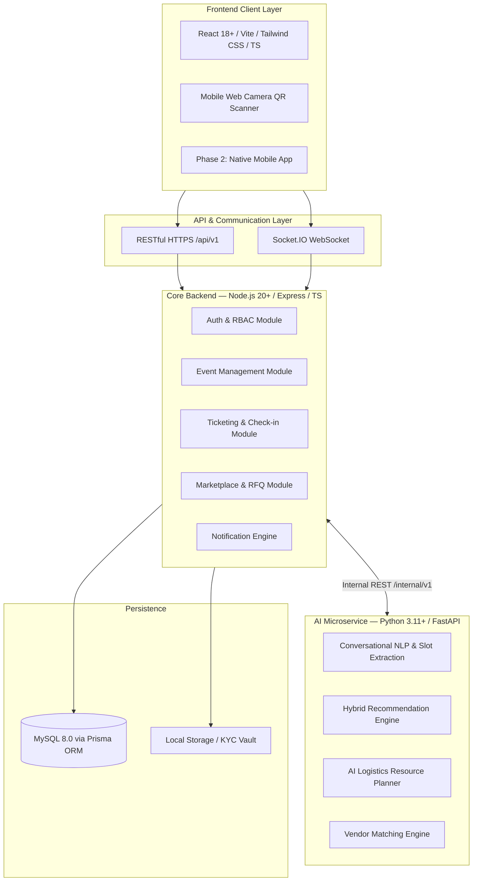

# System Architecture

> **Baseline references:** [`assets/phase1-analysis/phase1.md`](../assets/phase1-analysis/phase1.md) §1, §3, §4 and [`README.md`](../README.md) §8–§13. This document is the **living engineering reference** kept in sync with every PR.

---

## 1. Service Topology



| Service | Directory | Port | Base Path |
|---|---|---|---|
| Frontend | `frontend/` | 5173 | — |
| Backend | `backend/` | 5000 | `/api/v1` |
| AI Service | `ai-service/` | 8000 | `/internal/v1` |

### Architectural Decisions
- **ADR-0001:** [Modular Monolith + FastAPI AI Microservice](./adr/0001-modular-monolith-with-fastapi-ai.md)
- **ADR-0002:** [Advisory AI: Golden Rule and Fallback](./adr/0002-advisory-ai-golden-rule-and-fallback.md)

---

## 2. Golden Rule of AI

```
AI Microservice (Suggest) → Node.js Backend (Validate & Enforce) → User (Confirm) → Execute
```

If AI is unreachable, the backend falls back to keyword/SQL filtering. No user flow crashes.

---

## 3. Database Schema (3NF — 6 Domains)

### Domain 1 — Identity & Access
`roles`, `permissions`, `role_permissions`, `users`, `customers`, `organizers`, `execution_companies`

### Domain 2 — Events & Catalogs
`event_categories`, `venues`, `events`, `event_schedules`, `speakers`, `event_speakers`, `sponsors`

### Domain 3 — Ticketing & Gate Operations
`ticket_types`, `bookings`, `booking_items`, `tickets`, `qr_tickets`, `checkins`, `payments`

### Domain 4 — Marketplace & RFQ Procurement
`service_categories`, `services`, `company_services`, `service_requests`, `quotations`, `contracts`, `service_orders`

### Domain 5 — Interactions & Feedback
`reviews`, `favorites`, `notifications`, `notification_preferences`

### Domain 6 — AI Logs & Analytics
`ai_conversations`, `ai_messages`, `ai_recommendations`, `event_analytics`

> Full column definitions in [`assets/phase1-analysis/phase1.md`](../assets/phase1-analysis/phase1.md) §3.2.

### Naming Conventions
- Table names: `snake_case` plural (e.g., `ticket_types`)
- Primary key: `id`
- Foreign key: `<singular_entity>_id` (e.g., `event_id`)

---

## 4. API Contracts

### Unified Response Envelope
```json
{
  "success": true,
  "data": { },
  "meta": { "page": 1, "limit": 20, "total": 100 },
  "error": null
}
```

### REST Endpoints (Base: `/api/v1`)

#### Auth & User Management
- `POST /auth/register`, `/login`, `/logout`, `/forgot-password`, `/reset-password`, `/verify-email`
- `GET /users/me`, `PATCH /users/me`
- `GET|PATCH /users/me/notification-preferences`
- `GET /admin/users`, `PATCH /admin/users/:id/status`

#### Events & Discovery
- `GET /events` (filtered), `GET /events/:id`, `POST /events`, `PATCH /events/:id`
- `POST /events/:id/submit`, `POST /admin/events/:id/review`, `POST /events/:id/publish`
- `CRUD /events/:id/schedules`, `/speakers`, `/sponsors`
- `GET /categories`, `/venues`

#### Bookings, Payments & Check-in
- `POST /bookings`, `GET /bookings/:id`, `POST /bookings/:id/pay`, `POST /bookings/:id/cancel`
- `GET /tickets/me`, `GET /tickets/:id/qr`
- `POST /events/:id/waiting-list`
- `POST /checkins/verify` → Atomic: verify → `USED` → emit `attendance_update`

#### B2B Marketplace
- `GET /companies/:id`, `CRUD /companies/services`
- `POST /companies/kyc`, `PATCH /admin/companies/:id/kyc`
- `POST /rfq`, `GET /rfq`, `GET /rfq/:id`
- `POST /quotations`, `GET /rfq/:id/quotations`
- `PATCH /rfq/:id/select-vendor`
- `GET /service-orders`, `GET /service-orders/:id`, `PATCH /service-orders/:id/status`
- `POST /companies/:id/reviews`

#### Dashboards
- `GET /organizer/dashboard`, `GET /vendor/dashboard`, `GET /admin/analytics`
- `CRUD /admin/categories`

### AI Internal Contracts (Base: `/internal/v1`)
- `POST /nlp/chat` — Slot extraction and conversational discovery
- `POST /recommend/hybrid` — Hybrid recommendation scoring
- `POST /logistics/suggest` — Equipment and resource planning
- `POST /rfq/match` — Vendor matching and ranking

### Socket.IO Events
- `attendance_update` — `{ eventId, checkedInCount, totalCapacity }`

> Full request/response schemas in [`assets/phase1-analysis/phase1.md`](../assets/phase1-analysis/phase1.md) §4.
