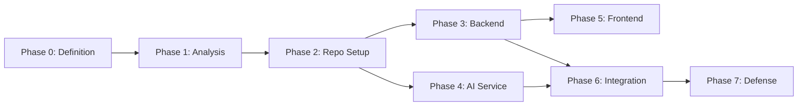

# Development Roadmap

> Tracks implementation phases and their success criteria. Update status in each phase-completion PR.

| Phase | Milestone | Status | Success Criteria |
|---|---|:---:|---|
| **0** | Project Definition | ✅ Done | Approved master summary document |
| **1** | Analysis & Modeling | ✅ Done | `phase1.md`: 39 user stories, 3NF schema, 78-screen inventory, API contracts |
| **2** | Local Repo Preparation | ✅ Done | `.gitignore`, `CONTRIBUTING.md`, templates, `README.md`, `SECURITY.md`, `AGENTS.md`, CI |
| **3** | Core Backend | 🔲 Planned | Node.js/Express/Prisma: auth, RBAC, CRUD, migrations pass `tsc --noEmit` + `npm run build` + tests |
| **4** | AI Microservice | 🔲 Planned | FastAPI: NLP chat, recommendations, logistics, vendor matching pass `ruff` + `pytest` |
| **5** | Frontend Web App | 🔄 In Progress | React/Vite/Tailwind: Foundations, Design System, & Attendee flow (A01–A06, S01–S02) implemented |
| **6** | Integration & Real-Time | 🔲 Planned | Socket.IO check-in, end-to-end booking flow, RFQ procurement, E2E integration tests |
| **7** | Academic Book & Defense | 🔄 In Progress | Chapters 1–4 documented, live demo deck prepared |

## Phase Dependencies

## Implementation Sequence for Active Phases

### Phase 3 — Core Backend (Next)
1. Bootstrap `backend/` with Express + TypeScript + Prisma
2. Implement Identity & RBAC module (JWT, roles, permissions)
3. Implement Events module (CRUD, state machine, admin moderation)
4. Implement Ticketing module (bookings, payments mock, QR signing, atomic check-in)
5. Implement Marketplace module (KYC, RFQ, quotations, contracts, service orders)
6. Implement Notification engine (in-app + email stubs)
7. Socket.IO gateway for gate check-in rooms

### Phase 4 — AI Microservice
1. Bootstrap `ai-service/` with FastAPI + Pydantic
2. NLP slot extraction endpoint (`POST /internal/v1/nlp/chat`)
3. Hybrid recommendation engine (`POST /internal/v1/recommend/hybrid`)
4. Logistics resource planner (`POST /internal/v1/logistics/suggest`)
5. Vendor matching engine (`POST /internal/v1/rfq/match`)

### Phase 5 — Frontend
1. Bootstrap `frontend/` with React 18 + Vite + Tailwind + TypeScript
2. Shared/System screens (S01–S10): login, register, error pages
3. Attendee screens (A01–A15): discovery, AI chat, booking, ticket wallet
4. Organizer screens (O01–O25): dashboard, event wizard, gate scanner, RFQ management
5. Vendor screens (V01–V16): onboarding, KYC, service catalog, quotation submission
6. Admin screens (AD01–AD12): KYC queue, event moderation, analytics
